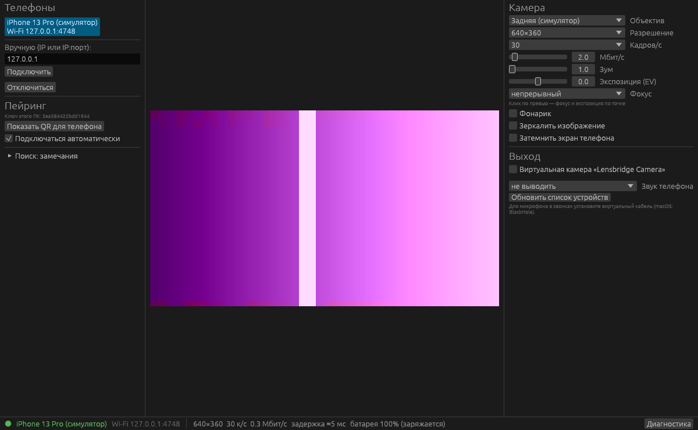

# Lensbridge

**Use your phone (iPhone or Android) as a webcam and microphone for your computer.** Open source, local network only (Wi-Fi or USB), encrypted, no cloud, no telemetry, no app stores: everything is installed manually from GitHub Actions / Releases.

[Русская версия](README.ru.md) · [Architecture](docs/ARCHITECTURE.md) (RU) · [Protocol](docs/PROTOCOL.md) (RU) · [Manual testing](docs/TESTING.md) (RU)

## Features

- Phone camera video (hardware H.264) and microphone audio (PCM 48 kHz) to the PC.
- Connections: Wi-Fi (manual IP, Bonjour/mDNS discovery, QR pairing) and USB (iPhone via usbmuxd, Android via `adb forward`, handled by the client).
- Any camera/lens, every resolution and frame rate the device reports (enumerated at runtime), bitrate, zoom, torch, mirroring, tap-to-focus/expose on the preview, exposure compensation.
- Battery saving: Android streams with the screen off (foreground service `camera|microphone` + wake lock + Wi-Fi lock); iOS dims the screen as far as possible (see limitations).
- ChaCha20-Poly1305 encryption with a key exchanged via QR code; LAN-only peers.
- Windows: **"Lensbridge Camera"** virtual camera (DirectShow) for Zoom, Discord, Teams, OBS, browsers; audio as a microphone via VB-Cable.
- Plain browser view: `http://PHONE-IP:4747/video` (MJPEG, unencrypted, off by default).
- Auto-reconnect, network loss / phone call / rotation handling; FPS, bitrate, latency, battery and thermal stats plus a diagnostics report.

## What is verified and what is not

| Component | Status |
|---|---|
| PC core (protocol, crypto, reconnect, decode, clock sync) | ✅ unit + end-to-end tests against a phone simulator in CI (Linux, Windows, macOS) |
| Desktop app | ✅ runs against the simulator (screenshot); ⚠️ **not yet tested with a real phone** |
| Crypto on iOS / Android / PC | ✅ the same test vector passes on all three; Android AEAD checked against RFC 8439 and the JDK |
| iOS app | ✅ builds in CI, protocol tests pass; ⚠️ **not run on a device** |
| Android app | ✅ builds in CI, tests pass; ⚠️ **not run on a device** |
| Windows virtual camera (DirectShow) | ✅ builds with MSVC (x64 + x86); ⚠️ **not tested in Zoom/OBS** |
| USB (usbmuxd / adb) | ✅ code and wire format unit-tested; ⚠️ **not tested with a cable** |

The project was written in a cloud environment without a phone or a Windows machine; items marked ⚠️ need a run through the [manual checklist](docs/TESTING.md).

## Quick start

**Downloads:** GitHub → Actions → CI → latest green run → Artifacts (or Releases after a `v*` tag, with `SHA256SUMS`): `Lensbridge-windows-x64.zip`, `Lensbridge-macos-universal.dmg`, `Lensbridge-linux-x64.tar.gz`, `Lensbridge-ios-unsigned.ipa`, `Lensbridge-android.apk`.

### iPhone + Windows

1. Unzip, right-click `install-vcam.cmd` → Run as administrator, start `lensbridge.exe` (SmartScreen: More info → Run anyway).
2. Install `Lensbridge-unsigned.ipa` with [Sideloadly](https://sideloadly.io) and a free Apple ID; enable Developer Mode on the iPhone and trust your Apple ID in Settings → General → VPN & Device Management. Free signing lasts 7 days, so reinstall or let Sideloadly/AltStore refresh it.
3. Open Lensbridge on the phone, allow camera, microphone and local network.
4. PC: "Показать QR для телефона" (show pairing QR) → phone: "Сопрячь с ПК" (scan).
5. Click the phone in the PC's device list (or type its IP). Pick **"Lensbridge Camera"** in Zoom/Discord/OBS.
6. Microphone: install [VB-Cable](https://vb-audio.com/Cable/), choose "CABLE Input" as phone audio output in Lensbridge and "CABLE Output" as the mic in your call app.
7. USB: install Apple Devices (Microsoft Store) or iTunes for the Apple Mobile Device service, plug in, tap Trust.

### Android + Windows

Install the APK (allow unknown sources), grant permissions, disable battery optimization, pair via QR. For USB enable USB debugging and install Android platform-tools (`adb` in PATH or next to `lensbridge.exe`). The screen can be turned off while streaming.

### macOS

For iPhone + Mac use Apple's built-in **Continuity Camera**. The Lensbridge Mac client shows the preview and can play audio into BlackHole; it has **no virtual camera** (a CoreMediaIO Camera Extension requires a paid Developer ID). Remove quarantine with `xattr -dr com.apple.quarantine /Applications/Lensbridge.app`.

## Limitations

- **iOS does not allow camera access in the background**: the app must stay in the foreground; screen lock, app switching or a phone call pause streaming (it resumes automatically). Use the dim mode to save battery.
- **Windows:** no own audio driver (needs Microsoft attestation signing with an EV certificate) → VB-Cable. The DirectShow camera is not visible to Media Foundation-only apps such as the Windows Camera app.
- Virtual camera output is capped at 1920×1080 (YUY2/RGB24, 5–60 fps).
- Android OEM battery savers may kill the service; Android sensor-based auto-rotation is untested on hardware (manual rotation override available).
- Linux client has no virtual camera yet (v4l2loopback not implemented).

## Building

`cd desktop && cargo test --workspace && cargo run --release -p lensbridge` (Linux needs `libasound2-dev`); phone simulator: `cargo run -p lb-sim -- --uri "<pairing link>"`; Windows filter: CMake + MSVC in `drivers/windows/dshow-filter`; iOS: XcodeGen in `mobile/ios`; Android: `./gradlew assembleRelease` in `mobile/android`. Details in [README.ru.md](README.ru.md).

## License

`MIT OR Apache-2.0`. Independent implementation, not affiliated with DroidCam, Iriun or others. DirectShow base classes (`drivers/windows/third_party/baseclasses`) are © Microsoft, MIT.
