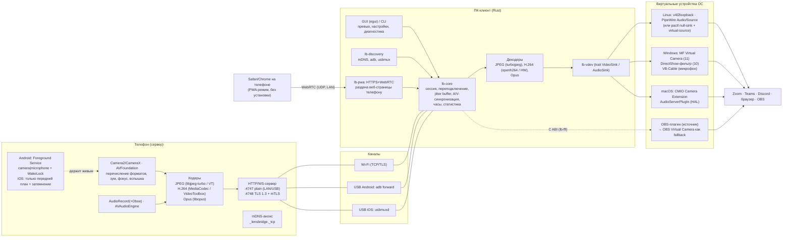

# Lensbridge — архитектура (этап 7.1)

> **Статус:** черновик на согласование. Кода ещё нет. «Lensbridge» — рабочее имя (см. «Открытые вопросы»).
> Детальная спецификация протокола: [`PROTOCOL.md`](PROTOCOL.md).

Содержание:

1. [Обзор и принципы](#1-обзор-и-принципы)
2. [Диаграмма компонентов](#2-диаграмма-компонентов)
3. [Технологический стек и обоснование](#3-технологический-стек-и-обоснование)
4. [Транспорт и протокол (кратко)](#4-транспорт-и-протокол-кратко)
5. [Виртуальные устройства по ОС](#5-виртуальные-устройства-по-ос)
6. [Матрица «платформа × что работает / ограничения»](#6-матрица-платформа--что-работает--ограничения)
7. [Структура монорепозитория](#7-структура-монорепозитория)
8. [Бюджет задержки и трафика](#8-бюджет-задержки-и-трафика)
9. [Надёжность, диагностика, тестирование](#9-надёжность-диагностика-тестирование)
10. [Риски](#10-риски)
11. [План этапов и критерии приёмки](#11-план-этапов-и-критерии-приёмки)
12. [Открытые вопросы к вам](#12-открытые-вопросы-к-вам)

---

## 1. Обзор и принципы

**Телефон — сервер**, **ПК — клиент**. Телефон снимает видео и звук, кодирует и раздаёт их по сети (Wi-Fi или USB-туннель). ПК-клиент принимает, синхронизирует, декодирует и отдаёт в **виртуальную камеру** и **виртуальный микрофон** ОС.

Принципы:

- **Честность.** Если что-то требует драйвера, прав администратора, платного сертификата или запрещено ОС, это написано в UI и в документации. Клиент сам проверяет, какие бэкенды доступны, и показывает понятную подсказку, а не «тихий» отказ.
- **Своя реализация.** Ни кода, ни бренда, ни протокола DroidCam/Iriun. Порт 4747 и путь `/video` взяты из ТЗ: это просто номер и путь, не совместимость.
- **Только локальная сеть.** Ни облака, ни телеметрии, ни STUN/TURN. Сервер на телефоне отклоняет подключения не с приватных адресов (RFC 1918, link-local, ULA, loopback).
- **Одно ядро, тонкие платформенные модули.** Вся логика (сеть, синхронизация, декодирование, диагностика) — в кроссплатформенном Rust. Платформенный код только там, где без него нельзя (COM-DLL для Windows, Camera Extension/HAL-плагин для macOS).
- **Тестируемость без телефона.** Симулятор телефона (`lb-sim`) говорит на том же протоколе, поэтому CI проверяет приём/синхронизацию/вывод без железа.

## 2. Диаграмма компонентов



Поток данных (MJPEG-режим, этап 1):

```
сенсор → YUV_420_888 → JPEG (NDK libjpeg-turbo) → multipart HTTP /video ──┐
микрофон → PCM 48 кГц → Opus 20 мс → WS /ws/media (pts) ──────────────────┤
                                                                          ▼
ПК: приём → оценка смещения часов → jitter buffer (аудио = мастер-часы)
    → JPEG-декод → YUYV/NV12 → v4l2loopback / MF / CMIO
    → Opus-декод → ресемплер (компенсация дрейфа) → PipeWire / VB-Cable / HAL
```

## 3. Технологический стек и обоснование

Ваш вариант по умолчанию в основном принимаю; ниже отличия и причины.

| Компонент | Выбор | Почему / отличие от вашего варианта |
|---|---|---|
| **Android** | Kotlin, **Camera2** (не CameraX) + NDK (libjpeg-turbo, libopus), MediaCodec (H.264), AudioRecord (Oboe опционально), **Ktor-server CIO** | CameraX удобен, но прячет нужное: точные `StreamConfigurationMap` (все разрешения/FPS), `CONTROL_AE_TARGET_FPS_RANGE`, ручной фокус/экспозицию и работу без превью-Surface при выключенном экране. Camera2 даёт полный контроль. Ktor CIO вместо NanoHTTPD: корутины, WebSocket и TLS «из коробки»; NanoHTTPD не развивается и без нормального WS. Opus через NDK, т.к. Opus-энкодер в MediaCodec есть только с API 29, а нам нужен API 26. |
| **iOS** | Swift, AVFoundation, VideoToolbox (H.264 и JPEG через `VTCompressionSession`/`CGImageDestination`), AVAudioEngine, Network.framework (`NWListener` + Bonjour), libopus (SPM) | Как у вас. Сервер на `NWListener` с собственным минимальным HTTP/WS-парсером (без сторонних зависимостей — проще AltStore-сборка). |
| **Десктоп-ядро** | Rust (tokio, hyper/axum-клиент, tokio-tungstenite, rustls, turbojpeg, openh264, opus, rubato, mdns-sd) | Как у вас. |
| **GUI** | **egui (eframe, wgpu)**, а не Tauri | Один нативный бинарник без WebView: на Windows 10 не всегда есть WebView2, на Linux WebKitGTK сильно различается по дистрибутивам (AppImage с ним тяжёлый и хрупкий). egui напрямую рисует кадр превью из wgpu-текстуры без копирования в JS. Минус — UI попроще; для утилиты это приемлемо. |
| **Windows-модули** | C++ (COM, WRL): MF media source DLL + DirectShow source filter (x64 и x86) | Неизбежно: Frame Server и DirectShow загружают COM-DLL. Rust здесь возможен (windows-rs), но C++ безопаснее по ABI с MF/DShow и проще для ревью драйверщиками. |
| **macOS-модули** | Swift (CMIO Camera Extension), C (AudioServerPlugIn, с нуля по образцу Apple NullAudio) | Неизбежно: Apple-фреймворки. |
| **OBS-плагин** | C + CMake (libobs), ядро через `lb-ffi` (staticlib, C ABI) | Стандарт для OBS-плагинов. |
| **PWA** | TypeScript без фреймворка (getUserMedia, RTCPeerConnection, Screen Wake Lock), на ПК — `webrtc-rs` | Чистый Rust, без сторонних серверов. |
| **H.264 на ПК** | openh264 (программно, переносимо) → затем HW (MF на Win, VideoToolbox на mac, VA-API на Linux) | openh264 даёт рабочий декод везде с первого дня; HW-декод — оптимизация. |
| **Сборка/CI** | GitHub Actions; cargo-deb, cargo-generate-rpm, appimagetool, WiX (MSI) или NSIS, create-dmg; Gradle; xcodebuild | Матрица по тегу, SHA256SUMS, опционально подпись Sigstore/minisign. |

**Транспорт для фазы 2 — отличие от ТЗ.** Для **нативных** клиентов (APK/iOS-приложение ↔ десктоп) предлагаю H.264 **поверх того же TCP/TLS-канала** (WebSocket `/ws/media`), а не WebRTC/RTP:

- USB-туннели (adb forward, usbmuxd) — это **только TCP**. RTP/UDP через них не пройдёт, пришлось бы держать два транспорта.
- WebRTC требует ICE/DTLS/SRTP и тяжёлой библиотеки на Android/iOS (libwebrtc ≈ 10–20 МБ), а выигрыша в LAN почти нет.
- Проблему «head-of-line blocking» TCP на Wi-Fi решаем на отправителе: ограниченная очередь, при переполнении — сброс кадров до следующего IDR + адаптивный битрейт + запрос ключевого кадра.

**WebRTC используем там, где без него нельзя:** в PWA-режиме (браузер не умеет сырой TCP). Если замеры на этапе 4 покажут, что TCP по Wi-Fi не укладывается в 150 мс, добавим опциональный RTP/UDP для Wi-Fi — протокол это предусматривает (см. `PROTOCOL.md`, §9).

## 4. Транспорт и протокол (кратко)

Полная спецификация — [`PROTOCOL.md`](PROTOCOL.md). Суть:

| Порт | Назначение | Защита |
|---|---|---|
| **4747** | HTTP/WS, plain. `/video` (MJPEG для браузера и fallback), `/info`, `/ws/control`, `/ws/media` | Только приватные адреса и loopback (USB). Опционально токен в URL. Можно выключить. |
| **4748** | То же поверх **TLS 1.3 + взаимная аутентификация (mTLS)** по закреплённым отпечаткам из QR-пейринга | Основной режим для Wi-Fi после пейринга. |
| 4749 (ПК) | HTTPS + WebRTC-сигналинг для PWA-режима | Самоподписанный сертификат ПК + одноразовый токен в QR. |
| эфемерный (ПК) | Окно пейринга (60–120 с) | TLS с отпечатком ПК в QR. |

- **Версионирование:** `lbp/<major>.<minor>`; major должен совпадать, minor — набор возможностей (capability flags).
- **Handshake:** `hello` → `welcome` (версия, сессия, возможности, время сервера) по `/ws/control`.
- **Видео (этап 1):** `GET /video` — `multipart/x-mixed-replace`; у каждой части заголовки `X-LB-Seq`, `X-LB-PTS` (мкс, монотонные часы телефона), `X-LB-Orientation`. Обычный браузер их игнорирует и просто показывает видео.
- **Медиа-кадры (аудио, затем H.264):** бинарные WS-сообщения с 16-байтовым заголовком: версия, тип потока, кодек, флаги, seq, pts.
- **Управление:** JSON по `/ws/control`: `get_caps`, `set` (камера, разрешение, FPS, кодек, качество/битрейт, зум, вспышка, зеркало, фокус, экспозиция), `request_keyframe`, `ping/pong` (синхронизация часов), периодические `stats`, события (`camera_interrupted`, `orientation`, …).
- **Синхронизация A/V:** все pts в одной временной базе телефона; ПК оценивает смещение часов по ping/pong (фильтр минимального RTT), аудио — мастер-часы, видео подстраивается под аудио; дрейф частоты дискретизации компенсируется ресемплингом ±0,5 %.
- **Пейринг:** QR на экране **ПК** (у телефона есть камера, у ПК — не всегда) → телефон подключается к окну пейринга ПК, проверяет отпечаток ПК из QR, передаёт одноразовый токен и свой отпечаток → дальше ПК подключается к телефону на 4748 по mTLS, обе стороны сверяют закреплённые отпечатки.

## 5. Виртуальные устройства по ОС

### 5.1 Linux (x64, arm64; X11 и Wayland не влияют на устройства — только на GUI)

**Камера — v4l2loopback (основной путь).**
- Модуль ядра вне дерева. Ставим пакет дистрибутива (Ubuntu/Debian `v4l2loopback-dkms`, Fedora — RPM Fusion `akmod-v4l2loopback`, Arch `v4l2loopback-dkms`) или собираем через DKMS из исходников, если пакета нет/старый.
- Скрипт `install-v4l2loopback.sh` (через `pkexec`/`sudo`): установка пакета, `/etc/modprobe.d/lensbridge.conf` с `devices=1 video_nr=<N> card_label="Lensbridge Camera" exclusive_caps=1 max_buffers=2`, `/etc/modules-load.d/lensbridge.conf` для автозагрузки, немедленный `modprobe`.
- `exclusive_caps=1` обязателен для Chrome/Chromium/WebRTC: устройство объявляет CAPTURE только когда в него пишут.
- Клиент пишет кадры в `/dev/videoN` (YUYV или I420 через `VIDIOC_S_FMT` + `write()`), при отсутствии сигнала — заставка «нет сигнала», чтобы приложения не теряли устройство.
- **Secure Boot:** неподписанный модуль не загрузится. Ubuntu DKMS сам создаёт MOK-ключ и просит пароль → при перезагрузке надо подтвердить в синем экране MokManager. Fedora: `mokutil --import` руками. Это одна ручная операция, документируем пошагово.
- **Иммутабельные дистрибутивы** (Silverblue, SteamOS): нужен `rpm-ostree install` / недоступно — честно указываем.
- Опциональный режим **без root**: нативный PipeWire-видеоузел (`media.class=Video/Source`). Видят только приложения, использующие камеры через PipeWire/портал (OBS 30+, Firefox с включённым PipeWire-камерой, GNOME Snapshot). Chrome/Zoom/Discord — нет. Поэтому только как дополнительный вариант.

**Микрофон — без root, создаётся и удаляется клиентом.**
- PipeWire (основной случай на современных дистрибутивах): клиент через `pipewire-rs` создаёт поток с `media.class=Audio/Source` и `node.name=lensbridge_mic` — он сразу появляется как микрофон и исчезает при выходе клиента (даже при падении: узел принадлежит процессу).
- PulseAudio (старые системы): `module-null-sink sink_name=lensbridge_sink` + `module-virtual-source master=lensbridge_sink.monitor source_name=lensbridge_mic`; ID модулей запоминаем и выгружаем при выходе; при старте подчищаем «осиротевшие» модули прошлого запуска (по имени).
- Определение: наличие сокета `$XDG_RUNTIME_DIR/pipewire-0` → PipeWire, иначе `pactl info`.

### 5.2 Windows 10/11 x64

**Камера, Windows 11 (build 22000+) — Media Foundation Virtual Camera.**
- `MFCreateVirtualCamera` регистрирует камеру, а кадры отдаёт **наш COM media source** (`lb_mfvcam.dll`, реализует `IMFMediaSource`/`IMFMediaStream` + `IKsControl`). DLL загружает служба **Windows Camera Frame Server** (svchost, учётная запись LOCAL SERVICE), а не наш процесс.
- **Драйвер ядра и подпись драйвера не нужны** — это user-mode COM. Админ нужен один раз: регистрация CLSID в HKLM (делает установщик), чтобы Frame Server мог загрузить DLL.
- Время жизни `MFVirtualCameraLifetime_Session`, доступ `CurrentUser`: камера существует, пока запущен клиент (прав администратора в рантайме не требует).
- IPC клиент → DLL: общий кольцевой буфер в разделяемой памяти + событие. Т.к. DLL работает в другом сеансе/учётке, секцию создаёт DLL в `Global\` с DACL, разрешающим запись интерактивному пользователю (у обычного пользователя нет `SeCreateGlobalPrivilege`, у LOCAL SERVICE — есть). Без сигнала — заставка.
- По документации MS камера видна MF-, WinRT- и DirectShow-приложениям; проверим на Zoom/Teams/Discord/Chrome/Камера Windows.

**Камера, Windows 10 — DirectShow source filter** (`lb_dshow_x64.dll` + `lb_dshow_x86.dll` для 32-битных приложений).
- Регистрация `regsvr32` (админ, делает установщик). Тот же IPC через разделяемую память (здесь DLL грузится в процесс приложения, поэтому `Local\` достаточно).
- **Ограничение:** видят только приложения на DirectShow (Zoom, Discord, Skype, OBS, Chrome/Edge/Firefox — да; приложение «Камера» Windows и часть UWP/MF-only — нет). Так же ведут себя OBS Virtual Camera и Unity Capture на Win10.
- На Win11 установщик по умолчанию ставит только MF-камеру; DirectShow — опционально (для старых 32-битных приложений), чтобы не было двух одинаковых камер.

**Микрофон — честно: собственного драйвера не будет (в v1).**
- Виртуальное аудиоустройство в Windows — только **драйвер ядра** (WaveRT/AVStream). Для загрузки на обычной системе (Secure Boot, без test-signing) нужна **подпись Microsoft через Partner Center** (attestation signing), а для неё — **EV-сертификат подписи кода** (~$300–600/год, проверка личности/юрлица). Test-signing-режим предлагать пользователям небезопасно и не будем.
- Решение: автоопределение **VB-Cable** (бесплатный donationware; лицензия VB-Audio запрещает включать его в наш установщик без договорённости, поэтому ставит пользователь сам). Клиент через WASAPI находит рендер-устройство `CABLE Input (VB-Audio Virtual Cable)` и пишет туда звук телефона; в Zoom выбирают микрофон `CABLE Output`. Также поддержим любые другие кабели (VoiceMeeter, VAC) по выбору устройства из списка.
- Если VB-Cable нет — UI показывает инструкцию и ссылку, а звук можно вывести на колонки для проверки.
- Путь на будущее: если у проекта появится EV-сертификат — свой драйвер на основе Microsoft `SimpleAudioSample`/SYSVAD (MS-PL, совместимо).

**SmartScreen / Smart App Control.** Без сертификата подписи кода: SmartScreen показывает «Windows защитила ваш компьютер» → «Подробнее» → «Выполнить в любом случае». **Smart App Control на Win11 (если включён) блокирует неподписанные бинарники полностью, без кнопки обхода** — его придётся выключить (необратимо без переустановки) или собрать/подписать самому. Это крупный риск, см. §10.

### 5.3 macOS 12.3+ (universal: x86_64 + arm64)

**Камера — CoreMediaIO Camera Extension.**
- System extension внутри `Lensbridge.app`. Приложение должно лежать в `/Applications`; при первом запуске вызывает `OSSystemExtensionRequest`, пользователь одобряет в «Системные настройки → Конфиденциальность и безопасность» (macOS 15: «Основные → Объекты входа и расширения → Расширения камеры»).
- Кадры передаём «правильным» способом из WWDC22: расширение публикует **sink-поток**, приложение кладёт `CMSampleBuffer` (NV12, IOSurface) через `CMIOStreamCopyBufferQueue`. Без самодельного IPC.
- DAL-плагины не рассматриваем: устарели в 12.3 и **не загружаются в macOS 14+**.
- **Жёсткое ограничение (подпись):** system extension загружается только если приложение подписано **Developer ID** с entitlement `com.apple.developer.system-extension.install`, нотаризовано и расширение подписано той же командой. Это требует **платного Apple Developer Program ($99/год)**. Бесплатный Apple ID/ad-hoc-подпись — не работает, кроме варианта для разработчиков: отключить SIP + `systemextensionsctl developer on` (не рекомендуем пользователям, документируем только для разработки).
- **Если платного аккаунта нет** — fallback для камеры на macOS: OBS-плагин Lensbridge → кнопка «Запустить виртуальную камеру» в OBS (у OBS своё подписанное расширение). Клиент обнаруживает отсутствие нашей камеры и сам подсказывает этот путь.

**Микрофон — AudioServerPlugIn (HAL), свой, с нуля по образцу Apple NullAudio.**
- Бандл `LensbridgeAudio.driver` в `/Library/Audio/Plug-Ins/HAL/` (нужен пароль администратора) + `sudo killall coreaudiod` (или перезагрузка).
- Это user-space плагин, не kext и не system extension: **платный аккаунт не обязателен**, достаточно ad-hoc-подписи (обязательна на Apple Silicon). Установщик `.pkg` без Developer ID вызовет предупреждение Gatekeeper — снимаем карантин (`xattr -dr com.apple.quarantine`) по инструкции.
- IPC: плагин работает внутри sandboxed `coreaudiod`; связь через Mach-сервис, объявленный ключом `AudioServerPlugIn_MachServices`, + разделяемый кольцевой буфер.
- Альтернатива: интеграция с **BlackHole** (если уже установлен): пишем звук в BlackHole как в обычное устройство вывода. Код BlackHole (GPL-3.0) не используем и не распространяем.

**Gatekeeper без Developer ID:** `.dmg`/`.app` неподписанные → «Не удаётся проверить разработчика». Обход: ПКМ → «Открыть», или `xattr -dr com.apple.quarantine /Applications/Lensbridge.app`, на macOS 15 — через «Конфиденциальность и безопасность → Всё равно открыть». Пишем прямо.

### 5.4 Универсальный fallback для камеры

- **OBS-плагин** (все ОС): источник «Lensbridge Camera» внутри OBS → встроенная OBS Virtual Camera. Чисто по лицензиям и не требует наших драйверов.
- Запись напрямую в разделяемую память OBS Virtual Camera без запуска OBS (как делает pyvirtualcam) возможна технически, но формат — внутренняя деталь GPL-проекта OBS без гарантий стабильности. Делаем **опционально, позже**, как «совместимость по интерфейсу», не копируя код. pyvirtualcam как зависимость не берём: это Python, а клиент — единый Rust-бинарник.
- **Клиент сам определяет доступные бэкенды** (наличие `/dev/videoN` с нужной меткой, зарегистрированный CLSID, активированное расширение, VB-Cable, OBS) и показывает в окне «Диагностика» таблицу: зелёный / нужна установка (кнопка) / недоступно (почему).

## 6. Матрица «платформа × что работает / ограничения»

### 6.1 ПК-клиент

| Платформа | Работает «из коробки» (без админа) | Нужна установка драйвера/модуля и права админа (один раз) | Пользователь делает руками | Невозможно / ограничения |
|---|---|---|---|---|
| **Linux x64/arm64** | Приём, превью, MJPEG в браузере, **виртуальный микрофон** (PipeWire / PulseAudio), PipeWire-видеоузел для OBS/Firefox | **v4l2loopback** (пакет/DKMS + modprobe.d + modules-load.d) — скрипт через pkexec | При Secure Boot — подтвердить MOK-ключ при перезагрузке; на иммутабельных дистрибутивах — rpm-ostree | Нет v4l2loopback на Silverblue/SteamOS без доп. шагов; ядро новее, чем поддерживает пакетная версия модуля → собираем из исходников |
| **Windows 11** | Приём, превью | **MF-камера:** регистрация COM-DLL в HKLM (установщик, UAC). Драйвер ядра не нужен | Установить **VB-Cable** вручную (микрофон); обойти SmartScreen; при включённом Smart App Control — выключить его или собрать/подписать самому | Свой виртуальный микрофон невозможен без EV-сертификата + подписи Microsoft |
| **Windows 10** | Приём, превью | **DirectShow-фильтр** x64+x86 (regsvr32, UAC) | VB-Cable; SmartScreen | Камеру не видят MF-only приложения (Камера Windows, часть UWP). Свой микрофон — как выше |
| **macOS 12.3+** (Intel/Apple Silicon) | Приём, превью | **HAL-плагин микрофона** (пароль админа, перезапуск coreaudiod). **Camera Extension** — одобрение в настройках | Снять карантин/Gatekeeper; одобрить расширение камеры; разрешить «Локальная сеть» | **Camera Extension работает только при подписи Developer ID ($99/год) + нотаризации.** Без этого — fallback через OBS. DAL-плагины на 14+ не работают |
| **OBS-плагин** (все ОС) | Источник в OBS + OBS Virtual Camera | Установка плагина в каталог OBS (на Windows — Program Files, UAC) | — | Работает, только пока открыт OBS |

### 6.2 Телефон

| Платформа | Работает | Ограничения / ручные шаги |
|---|---|---|
| **Android 8–15+ (APK)** | Камера, микрофон, все форматы/FPS устройства, зум/вспышка/фокус/экспозиция, H.264, Opus, **экран выключен** (foreground service `camera\|microphone` + partial WakeLock), mDNS, USB через adb | Разрешить установку из неизвестных источников. Для USB — включить «Отладку по USB». Android 11+: FGS с камерой нельзя запустить из фона — старт только из видимого приложения (так и делаем). Android 14+: нужны `FOREGROUND_SERVICE_CAMERA/MICROPHONE`. Агрессивные прошивки (Xiaomi, Huawei, Samsung, OnePlus) убивают сервис — инструкция «исключить из оптимизации батареи» (по dontkillmyapp.com). Входящий звонок отбирает микрофон, другое приложение — камеру: шлём событие, восстанавливаемся автоматически |
| **Android без APK (PWA)** | Камера+микрофон через Chrome, WebRTC | Экран должен быть включён (Wake Lock API), нет ручного фокуса/экспозиции (только то, что даёт `MediaTrackConstraints`), нужно принять самоподписанный сертификат |
| **iOS 15+ (приложение)** | Камера, микрофон, форматы/FPS устройства, зум, вспышка, фокус/экспозиция, H.264 (VideoToolbox), USB через usbmuxd, mDNS | **Камера в фоне запрещена iOS** (сессия прерывается с `videoDeviceNotAvailableInBackground`). Приложение должно быть на экране; блокировка экрана отключается (`isIdleTimerDisabled`), режим «затемнение»: яркость 0 + чёрный оверлей (на OLED экономит заметно, на LCD — подсветка всё равно светится). Входящий звонок прерывает сессию — восстанавливаемся после. Установка без App Store — см. ниже |
| **iOS: способы установки** | (а) сборка в Xcode с бесплатным Apple ID; (б) неподписанный `.ipa` для AltStore/SideStore/Sideloadly; (в) PWA | (а) подпись живёт **7 дней**, не более 3 приложений и 10 App ID в неделю, нужен Mac; (б) AltStore/SideStore переподписывают вашим Apple ID и **автопродлевают** каждые 7 дней (AltStore — нужен AltServer на ПК в той же сети; SideStore — однократный пейринг, затем на устройстве через VPN-петлю); с iOS 16 нужно включить «Режим разработчика»; (в) экран включён, Safari 16.4+ для Wake Lock (на 15.x — обходной трюк с невидимым видео), принять сертификат. Альтернативные маркетплейсы ЕС (AltStore PAL) требуют нотаризации Apple и платного аккаунта — вне рамок |

## 7. Структура монорепозитория

```
phone-as-webcam/
├── README.md · README.ru.md · LICENSE-MIT · LICENSE-APACHE · CONTRIBUTING.md
├── docs/
│   ├── ARCHITECTURE.md        ← этот документ
│   ├── PROTOCOL.md            ← спецификация протокола lbp/1
│   ├── install/{android,ios,windows,linux,macos,obs}.{en,ru}.md
│   ├── FAQ.{en,ru}.md
│   └── testing/manual-checklists.md
├── protocol/
│   ├── control.schema.json    ← JSON Schema управляющих сообщений
│   └── vectors/               ← эталонные бинарные кадры для тестов совместимости
├── mobile/
│   ├── android/               ← Gradle, Kotlin + NDK (libjpeg-turbo, libopus)
│   │   ├── app/               ← UI, сервис, камера, аудио, сервер
│   │   └── fdroid/            ← метаданные для F-Droid-совместимой сборки
│   └── ios/                   ← XcodeGen project.yml (без .xcodeproj в git), Swift
├── desktop/                   ← Cargo workspace
│   ├── crates/
│   │   ├── lb-proto/          ← типы протокола, парсер заголовков, общий для всех Rust-частей
│   │   ├── lb-core/           ← сессия, переподключение, часы, jitter buffer, A/V-синхронизация, статистика
│   │   ├── lb-codec/          ← JPEG/H.264/Opus декод, конвертация цвета, ресемплинг
│   │   ├── lb-discovery/      ← mDNS, adb (forward/reverse), usbmux-клиент
│   │   ├── lb-vdev/           ← trait VideoSink/AudioSink + бэкенды:
│   │   │                         v4l2, pipewire, pulse, win_mf, win_dshow, wasapi_cable,
│   │   │                         mac_cmio, mac_hal, obs_shm(опц.), null
│   │   ├── lb-pairing/        ← сертификаты, хранилище отпечатков, QR, окно пейринга
│   │   ├── lb-pwa/            ← HTTPS + WebRTC (webrtc-rs) + встраивание web/pwa
│   │   └── lb-ffi/            ← C ABI для OBS-плагина
│   ├── apps/
│   │   ├── lensbridge/        ← GUI (egui)
│   │   └── lensbridge-cli/    ← headless-режим, удобно для Linux/сервисов и CI
│   └── tools/
│       ├── lb-sim/            ← симулятор телефона (тестовый генератор видео/звука на протоколе lbp)
│       └── lb-latency/        ← замер задержки «стекло-в-стекло» по экранному тайм-коду
├── drivers/
│   ├── windows/
│   │   ├── mf-vcam/           ← C++ COM media source для MFCreateVirtualCamera
│   │   ├── dshow-filter/      ← C++ DirectShow source filter (x64 + x86)
│   │   └── common/            ← формат общего кольцевого буфера (заголовок C, общий с Rust через bindgen)
│   ├── macos/
│   │   ├── camera-extension/  ← Swift CMIO Camera Extension
│   │   └── audio-hal/         ← C AudioServerPlugIn
│   └── linux/
│       ├── install-v4l2loopback.sh
│       ├── uninstall-v4l2loopback.sh
│       └── modprobe.d/ · modules-load.d/
├── obs-plugin/                ← C, CMake, линкуется с lb-ffi
├── web/pwa/                   ← TypeScript, собирается в статику, встраивается в lb-pwa
├── packaging/
│   ├── windows/ (wix/ или nsis/, portable-zip)
│   ├── linux/ (appimage/, deb/rpm метаданные, .desktop, иконки)
│   └── macos/ (dmg, pkg для HAL-плагина, entitlements)
└── .github/workflows/
    ├── ci.yml                 ← lint + тесты на каждый PR
    └── release.yml            ← матричная сборка по тегу v*, SHA256SUMS, публикация релиза
```

## 8. Бюджет задержки и трафика

Оценка «от сенсора до кадра в виртуальной камере» (то, что контролируем мы; внутренний конвейер Zoom/Teams добавляет свои 30–100 мс и от нас не зависит):

| Этап | MJPEG 720p30, Wi-Fi 5 ГГц | H.264 1080p30, Wi-Fi 5 ГГц | H.264 1080p60, USB |
|---|---|---|---|
| Экспозиция + выдача кадра камерой | 20–35 мс | 20–35 мс | 10–20 мс |
| Кодирование | 5–12 мс (libjpeg-turbo) | 8–20 мс (MediaCodec, low-latency) | 5–15 мс |
| Сеть | 3–15 мс (джиттер Wi-Fi!) | 2–10 мс | 1–3 мс |
| Jitter buffer | 15–40 мс (адаптивный) | 15–40 мс | 5–15 мс |
| Декод + конвертация + запись в vdev | 4–8 мс | 4–10 мс | 3–8 мс |
| **Итого** | **≈ 50–110 мс** | **≈ 50–115 мс** | **≈ 25–60 мс** |

Цели ТЗ (< 150 мс Wi-Fi, < 100 мс USB) реалистичны, **но**: на 2,4 ГГц, при плохом сигнале или в нагруженной сети цель не гарантируется; часть Android-устройств (особенно бюджетные MediaTek) имеет энкодеры H.264 с буферизацией 3–5 кадров (+100–150 мс), обходим флагами `KEY_LOW_LATENCY` (API 30+), `KEY_LATENCY`, отключением B-кадров, а на «плохих» моделях рекомендуем MJPEG. Замер — инструментом `lb-latency` (ПК показывает тайм-код, телефон его снимает, ПК сравнивает).

Трафик: MJPEG 720p30 q80 ≈ 15–25 Мбит/с, 1080p30 ≈ 35–60 Мбит/с (для 2,4 ГГц — много, UI предупредит); H.264 1080p30 ≈ 4–8 Мбит/с; Opus 48 кГц моно 64 кбит/с; PCM 48 кГц моно s16 = 768 кбит/с (только USB/LAN).

## 9. Надёжность, диагностика, тестирование

- **Автопереподключение:** конечный автомат сессии (`Discovering → Connecting → Handshaking → Streaming → Reconnecting(backoff 0.5→8 с)`); при потере сети виртуальная камера получает заставку «переподключение» (а не исчезает — иначе Zoom «теряет» камеру), микрофон — тишину.
- **Телефон:** обработка `CameraDevice.onDisconnected/onError`, `AVCaptureSessionWasInterrupted`, фокуса аудио/`AVAudioSession.interruptionNotification` (звонок), смены сети (`ConnectivityManager.NetworkCallback` / `NWPathMonitor`), смены ориентации (ориентация в метаданных + опция фиксации).
- **Метрики:** FPS (вход/выход), задержка (оценка по pts + смещению часов), битрейт, потери/дропы, глубина буферов, температура и батарея телефона. Лог в файл (с ротацией), окно «Диагностика» с кнопкой «Скопировать отчёт» (без персональных данных, отпечатки укорочены).
- **Тесты:** юнит-тесты `lb-proto`/`lb-core` (парсинг, синхронизация часов, jitter buffer на синтетическом джиттере), интеграционные `lb-sim ↔ lensbridge-cli` в CI, на Linux-раннере — с реальным v4l2loopback (модуль ставится в CI) и проверкой кадров через `ffmpeg -f v4l2`; Android — instrumented-тесты протокола; ручные чек-листы на каждом этапе.

## 10. Риски

| # | Риск | Вероятность / влияние | Что делаем |
|---|---|---|---|
| R1 | **macOS Camera Extension требует платного Apple Developer ID** | Определённо / высокое | Без аккаунта — fallback через OBS-плагин; код расширения всё равно пишем и даём инструкцию для владельцев аккаунта (собрать со своим Team ID). Нужно ваше решение (§12) |
| R2 | **Windows: нет своего виртуального микрофона без EV-сертификата + подписи MS** | Определённо / среднее | VB-Cable с автоопределением; драйвер — отложенная задача при наличии сертификата |
| R3 | **SmartScreen / Smart App Control** блокируют неподписанные exe/dll на Windows | Высокая / высокое | Инструкции; reproducible builds + SHA256; предложить SignPath.io (бесплатная подпись для OSS) или Azure Trusted Signing (~$10/мес) |
| R4 | MF virtual camera: IPC между сеансом пользователя и Frame Server (LOCAL SERVICE), права на `Global\` объекты | Средняя / высокое | Спайк в начале этапа 2: секцию создаёт DLL с явным DACL; запасной вариант — named pipe |
| R5 | Secure Boot + DKMS (MOK), несовместимость v4l2loopback с новым ядром | Средняя / среднее | Пошаговая инструкция MOK; сборка свежей версии из исходников; PipeWire-видеоузел как частичный обход |
| R6 | Агрессивные энергосбережения OEM на Android убивают сервис при выключенном экране | Высокая / среднее | FGS + WakeLock + запрос исключения из оптимизации батареи + инструкции по производителям; автопереподключение на ПК |
| R7 | Задержка энкодеров H.264 на части Android-устройств | Средняя / среднее | Low-latency флаги, без B-кадров, малый GOP/intra-refresh; MJPEG как запасной; список проверенных устройств |
| R8 | PWA: самоподписанный сертификат на iOS Safari — getUserMedia после «Посетить сайт» может вести себя непредсказуемо между версиями | Средняя / среднее | Спайк в начале этапа 3; надёжный вариант — установка локального CA-профиля на iPhone (Настройки → Основные → Об устройстве → Доверие сертификатам), инструкция |
| R9 | Head-of-line blocking TCP по Wi-Fi → всплески задержки | Средняя / среднее | Сброс кадров на отправителе, адаптивный битрейт; опциональный RTP/UDP, если замеры не укладываются |
| R10 | Патенты H.264 | Низкая для OSS / среднее | На телефоне — системные кодеры (лицензированы производителем); на ПК — бинарный openh264 от Cisco (Cisco платит роялти) или системные декодеры ОС; документируем |
| R11 | Лицензии: OBS (GPLv2+), VB-Cable (проприетарная), BlackHole (GPL-3) | Низкая / высокое | Ничего из них не копируем и не бандлим; OBS-плагин как отдельный артефакт, совместимый с GPL (MIT/Apache-2.0 совместимы с GPLv3, OBS — «v2 or later») |
| R12 | Брандмауэр ПК блокирует окно пейринга / PWA-порт | Высокая / низкое | Windows: правило брандмауэра в установщике; fallback — пейринг по короткому коду, который ПК вводит вручную (SPAKE2), без входящих подключений на ПК |
| R13 | iOS-сайдлоад: бесплатный Apple ID — 7 дней, лимиты App ID; изменения политики Apple | Высокая / среднее | Поддержка AltStore/SideStore (автопродление) + PWA как установка «без ничего» |
| R14 | Объём работ: 5 этапов × 6 платформ — очень большой проект; часть (iOS, macOS-подпись, Windows-драйверы) нельзя проверить в CI без железа | Определённо / высокое | Чёткое разделение «проверено в CI / проверено вручную / требует проверки владельцем железа» в отчёте по каждому этапу. Я не могу сам запустить код на телефоне и на Windows/macOS-машине из этой облачной среды — буду явно помечать, что проверено только сборкой |

## 11. План этапов и критерии приёмки

Подробные чек-листы будут в начале каждого этапа; здесь — критерии «готово».

**Этап 1 — MVP: Android + Linux + MJPEG по Wi-Fi + v4l2loopback**
- Android-приложение: выбор камеры, динамический список разрешений/FPS, запуск FGS, `/video` на 4747 открывается в браузере ПК, `/info`, `/ws/control` (caps, set, ping), аудио Opus по `/ws/media`, mDNS-анонс.
- Linux-клиент (CLI + базовый GUI): обнаружение по mDNS/ввод IP, приём MJPEG+Opus, синхронизация, вывод в v4l2loopback и виртуальный микрофон PipeWire/Pulse, автопереподключение, заставка при обрыве, статистика.
- Скрипт установки v4l2loopback.
- **Приёмка:** камера и микрофон видны и работают в Chrome (meet/webrtc-тест), Firefox, OBS, Zoom/Discord на Linux; экран телефона выключен 30 мин — поток не прерывается (на тестовом устройстве без агрессивного OEM); выключение Wi-Fi на 10 с → автоматическое восстановление ≤ 5 с; задержка MJPEG 720p30 ≤ 150 мс по `lb-latency` на 5 ГГц; `lb-sim ↔ cli` в CI зелёный.

**Этап 2 — Windows и macOS клиенты, виртуальные камеры, аудио**
- Windows: MF-камера (11), DirectShow x64/x86 (10), VB-Cable-вывод, установщик с регистрацией.
- macOS: Camera Extension (+ инструкция по подписи), HAL-плагин микрофона, BlackHole-интеграция, OBS-fallback подсказка.
- **Приёмка:** камера видна в Zoom, Teams, Discord, Chrome, OBS на Win10, Win11, macOS 13/14/15; микрофон — через VB-Cable (Win) и HAL (mac); при выходе клиента камера/микрофон исчезают или показывают заставку без зависаний приложений-потребителей.

**Этап 3 — USB (adb, usbmuxd), iOS-приложение, PWA-режим**
- adb: автоопределение устройства, `adb forward tcp:4747`; usbmux-клиент на Rust (macOS/Linux — сокет usbmuxd, Windows — служба Apple Mobile Device).
- iOS-приложение с паритетом функций (кроме фона), затемнение экрана.
- PWA: HTTPS на ПК, QR, getUserMedia + WebRTC, Wake Lock.
- **Приёмка:** USB-задержка ≤ 100 мс; iOS 15/16/17/18 — поток в приложение на ПК; PWA работает в Safari iOS 16.4+ и Chrome Android.

**Этап 4 — H.264, шифрование и QR-пейринг, OBS-плагин**
- H.264 MediaCodec/VideoToolbox → `/ws/media`, адаптивный битрейт, keyframe-request; TLS 1.3 + mTLS на 4748, QR-пейринг, отзыв устройств; OBS-плагин (Win/mac/Linux).
- **Приёмка:** трафик 1080p30 ≤ 8 Мбит/с; без пейринга подключение к 4748 невозможно (проверка негативными тестами); подмена сертификата → отказ; источник в OBS работает.

**Этап 5 — CI/CD, установщики, документация, тесты**
- `release.yml`: APK (подписанный ключом из секретов), неподписанный `.ipa`, Windows `.zip` + `.msi`, Linux AppImage/`.deb`/`.rpm` (x64+arm64), macOS universal `.dmg` + `.pkg` HAL, OBS-плагин; SHA256SUMS.
- README EN/RU со скриншотами, быстрый старт на 5 минут для каждой платформы, FAQ.
- **Приёмка:** тег `v*` → релиз со всеми артефактами и контрольными суммами без ручных шагов.

## 12. Открытые вопросы к вам

Нужны ответы до начала кода (по каждому есть вариант по умолчанию):

1. **Имя проекта.** Рабочее — `Lensbridge`. Альтернативы: `Pocketcam`, `Camtether`, `Lumino`. *По умолчанию: Lensbridge* (перед релизом проверим, не занято ли).
2. **Лицензия.** *По умолчанию: двойная `MIT OR Apache-2.0`* (стандарт Rust; Apache даёт патентный грант, MIT упрощает совместимость с GPL-кодом OBS).
3. **Платный Apple Developer ($99/год) будет?** Без него macOS-камера только через OBS (R1). *По умолчанию: нет — пишем расширение, но основной путь на macOS документируем через OBS.*
4. **Подпись кода для Windows** (SignPath для OSS / Azure Trusted Signing / нет)? *По умолчанию: нет, инструкции по SmartScreen.*
5. **GUI: egui вместо Tauri** — согласны? *По умолчанию: egui.*
6. **Транспорт фазы 2:** H.264 поверх TCP/TLS для нативных клиентов, WebRTC только для PWA (вместо WebRTC/RTP везде) — согласны? *По умолчанию: да.*
7. **Камера Android: Camera2 вместо CameraX** — согласны? *По умолчанию: да.*
8. **Минимальная версия macOS-клиента:** 12.3 (по ТЗ) или 13? На 12.x Camera Extension работает, но с багами в первых версиях. *По умолчанию: 12.3.*
