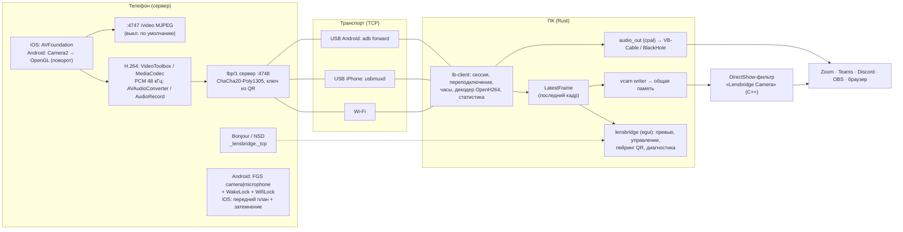

# Lensbridge — архитектура

> Документ описывает **реализованное** состояние. Протокол — [`PROTOCOL.md`](PROTOCOL.md), проверка на железе — [`TESTING.md`](TESTING.md).
> Первоначальный план (все платформы, 5 этапов) лежит в истории git (коммит `3aa3aa5`); ниже — что из него сделано, что изменено и почему.

## 1. Обзор

Телефон — **сервер**, ПК — **клиент**. Телефон кодирует видео в H.264 аппаратным кодером, звук отдаёт как PCM, и всё это вместе с управлением идёт в **одном зашифрованном TCP-соединении** (порт 4748). Это соединение одинаково работает по Wi-Fi и через USB-туннели (usbmuxd для iPhone, `adb forward` для Android). ПК декодирует видео и публикует кадры в виртуальную камеру, а звук выводит в устройство (виртуальный кабель становится микрофоном).

## 2. Компоненты и где они в репозитории

| Путь | Язык | Что делает |
|---|---|---|
| `desktop/crates/lb-proto` | Rust | Протокол: handshake, HKDF + ChaCha20-Poly1305, кадры, медиазаголовок, URI пейринга. Без зависимостей от ОС |
| `desktop/crates/lb-client` | Rust | Сессия с автопереподключением (0,5 → 5 с), синхронизация часов (ping/pong, минимальный RTT), декодер H.264 (OpenH264), слот «последний кадр», транспорты TCP / usbmuxd / adb, вывод звука с ресемплингом и контролем буфера |
| `desktop/apps/lensbridge` | Rust (egui) | GUI: поиск (mDNS + USB), ручной IP, QR-пейринг, превью с фокусом по клику, управление камерой по `caps`, выходы (виртуальная камера, звук), диагностика. Ключ на Windows защищён DPAPI. Рендер: wgpu, запасной — OpenGL |
| `desktop/tools/lb-sim` | Rust | Симулятор телефона: H.264 тест-паттерн + тон, mDNS. Для разработки и CI |
| `drivers/windows/dshow-filter` | C++ | DirectShow source filter «Lensbridge Camera»: читает кадры из общей памяти, масштабирует с полосами, YUY2/RGB24, 6 размеров, 5–60 к/с, заставка «нет сигнала» |
| `drivers/windows/common/lb_vcam_shm.h` | C | Формат общей памяти: заголовок + два слота с seqlock (общий с Rust) |
| `drivers/windows/third_party/baseclasses` | C++ | Базовые классы DirectShow от Microsoft (MIT), без изменений |
| `mobile/ios` | Swift | Приложение iOS 15+: захват, VideoToolbox, AVAudioConverter, сервер на Network.framework, Bonjour, Keychain, QR-сканер, MJPEG, затемнение |
| `mobile/android` | Kotlin + Java | Приложение Android 8+: Camera2 → SurfaceTexture → GL-поворот → MediaCodec; AudioRecord; foreground service; NSD; Keystore; ZXing; собственный ChaCha20-Poly1305 (Android даёт его только с API 28) |
| `.github/workflows/ci.yml` | YAML | Тесты на Linux/Windows/macOS, сборка всех артефактов, релиз по тегу `v*` с `SHA256SUMS` |

## 3. Потоки данных и многопоточность

**Телефон.** Захват → кодер → `sendMedia`. Перед отправкой проверяется очередь: если в ней больше ~150 мс видео (`bitrate × 0,15`), кадр выбрасывается, следующий IDR запрашивается сразу, и ПК получает флаг `DISCONT`. Так TCP по Wi-Fi не копит задержку: при плохой сети теряются кадры, а не время. Шифрование и отправка идут в одном последовательном потоке на сессию (счётчик nonce строго по порядку).

**ПК.** Поток сессии пишет команды и ping. Поток чтения расшифровывает, декодирует H.264 и публикует кадр в `LatestFrame`, а звук отдаёт в аудиосинк. Потребители (превью, запись в виртуальную камеру) читают слот независимо: медленный потребитель пропускает кадры, задержка не растёт. Слот общий для всех переподключений, поэтому виртуальная камера при обрыве не пропадает, а показывает «нет сигнала» (кадров нет дольше 1,5 с).

**Виртуальная камера (Windows).** Rust пишет I420 в свободный из двух слотов: seq становится нечётным, данные копируются, seq становится чётным, переключается `latest_slot` и обновляется heartbeat. Фильтр в процессе Zoom копирует последний слот и проверяет seq. Если seq был нечётным или изменился во время копирования, фильтр повторяет попытку, а при повторной неудаче отдаёт предыдущий кадр. Фильтр сам выдерживает темп кадров и ставит метки по часам графа.

**Звук.** PCM → (стерео → моно) → линейный ресемплер к частоте устройства → FIFO с целевым заполнением 60 мс. При переполнении сверх 200 мс старые данные сбрасываются, при опустошении играет тишина до повторного заполнения. Дрейф частот компенсируется сбросами, без разрывов звука в нормальной работе.

**Синхронизация.** Все метки — время захвата в монотонных часах телефона (iOS: host time; Android: `System.nanoTime`, метки камеры приводятся к этой базе). ПК оценивает смещение часов по ping/pong раз в секунду (окно 30 с, лучший RTT) и показывает задержку «захват → декодирование».

## 4. Безопасность

- Пейринг: ПК генерирует 32-байтовый ключ и показывает QR. Телефон сохраняет ключ в Keychain (iOS) или в зашифрованном Android Keystore хранилище. По сети ключ не передаётся никогда.
- Каждое соединение: свежие nonce с обеих сторон → HKDF → ключи на каждое направление → ChaCha20-Poly1305 со строгим счётчиком (повтор или пропуск кадра обрывает соединение). Первый зашифрованный кадр клиента — `hello`, он доказывает, что у клиента есть ключ.
- Телефон принимает подключения только с loopback, частных, link-local и ULA-адресов. HTTP 4747 без шифрования, выключен по умолчанию.
- Отличие от исходного ТЗ («TLS с pinning»): iOS не умеет генерировать X.509, а rustls не поддерживает внешний PSK. Схема с общим ключом из QR даёт те же свойства без сертификатов (подробнее — PROTOCOL.md §3).

## 5. Матрица платформ (что реализовано)

| Платформа | Работает без админа | Нужна установка с правами админа | Делаете руками | Невозможно / не сделано |
|---|---|---|---|---|
| **Windows 10/11** (клиент) | Приём, превью, управление, звук в любое устройство | Виртуальная камера: `install-vcam.cmd` (regsvr32 x64 + x86) | Обойти SmartScreen; поставить VB-Cable для микрофона; для iPhone по USB — «Устройства Apple»/iTunes; для Android по USB — platform-tools | Свой драйвер микрофона (нужна подпись Microsoft + EV); камеру не видят MF-only приложения; MF Virtual Camera (Win11) не реализована — DirectShow-камера работает и на 11 |
| **macOS** (клиент) | Приём, превью, звук (в BlackHole — как микрофон), USB для iPhone | — | Снять карантин (`xattr`); поставить BlackHole | Виртуальная камера: CMIO Extension требует Developer ID. Для iPhone — «Камера Continuity» |
| **Linux** (клиент) | Приём, превью, звук | — | — | Виртуальная камера (v4l2loopback) в этой сборке не реализована |
| **iPhone** (iOS 15+) | Камера, микрофон, все форматы, управление, Wi-Fi, USB, затемнение | — | Установка: Xcode + бесплатный Apple ID (7 дней) или `.ipa` через Sideloadly/AltStore/SideStore; режим разработчика | Камера в фоне — запрещено iOS |
| **Android** (8+) | Камера, микрофон, все форматы, управление, Wi-Fi, USB, **работа с выключенным экраном** | — | Разрешить установку APK; отключить оптимизацию батареи; для USB — отладка по USB | Убийство службы агрессивными прошивками (инструкции на dontkillmyapp.com) |

## 6. Сравнение с исходным планом

| Пункт ТЗ | Состояние |
|---|---|
| Протокол, шифрование, QR-пейринг, mDNS, ручной IP, автопереподключение | ✅ |
| H.264 аппаратно (VideoToolbox / MediaCodec) | ✅ сразу, без промежуточного MJPEG-транспорта (MJPEG оставлен только для браузера на 4747) |
| Звук | ✅ PCM (Opus не нужен в LAN/USB: 0,77 Мбит/с) |
| USB: usbmuxd (iOS), adb (Android) | ✅ код; ⚠️ проверка с кабелем |
| iOS и Android приложения, все функции управления, экран выкл./затемнён | ✅ код + сборка в CI; ⚠️ проверка на устройствах |
| Windows: DirectShow-камера | ✅; MF Virtual Camera — нет (не нужна для Windows 10) |
| Windows: микрофон | VB-Cable (свой драйвер невозможен без EV-подписи) |
| macOS: камера / микрофон | Нет (Developer ID) → «Камера Continuity», BlackHole |
| Linux: v4l2loopback, PipeWire-микрофон | Не сделано (Linux не входит в ваши платформы) |
| PWA-режим (браузер телефона → ПК) | Не сделано |
| OBS-плагин | Не сделано: «Lensbridge Camera» видна в OBS как обычная камера |
| Установщики MSI/NSIS, AppImage, deb/rpm, F-Droid | Не сделано: zip / dmg / tar.gz / apk / ipa |
| CI/CD с релизом и чек-суммами | ✅ |
| Диагностика, статистика, README RU/EN, FAQ, тесты | ✅ |

## 7. Задержка (ожидаемая, Wi-Fi 5 ГГц, 1080p30)

Экспозиция и выдача кадра 20–35 мс + кодирование 8–20 мс + сеть 2–10 мс + декодирование и вывод 5–10 мс + буфер приложения-потребителя. Своего jitter buffer для видео нет (минимальная задержка, кадр показывается сразу по готовности). Итого ожидается **60–120 мс** по Wi-Fi и меньше по USB. Измерять — по методике из TESTING.md §5.

## 8. Риски и следующие шаги

1. **Проверка на железе** (TESTING.md) — главный риск: ориентация на Android, фильтр DirectShow в конкретных приложениях, USB.
2. Задержка энкодеров на дешёвых Android-устройствах (буферизация 3–5 кадров) — флаги low-latency уже выставлены; при проблемах — снизить разрешение.
3. Подпись: SmartScreen и Gatekeeper предупреждают — бесплатный вариант подписи для OSS: SignPath.io (Windows).
4. Возможные доработки: Media Foundation Virtual Camera (Win11), v4l2loopback (Linux), Opus для слабого Wi-Fi, установщик MSI, PWA-режим.
